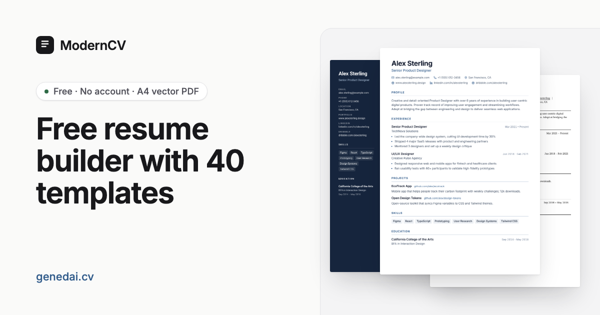

<div align="center">

# ModernCV - AI Resume Builder


[](https://opensource.org/licenses/MIT)
[](https://react.dev/)
[](https://www.typescriptlang.org/)
[](https://tailwindcss.com/)
[](https://vite.dev/)
[](https://developers.cloudflare.com/workers-ai/)
[](http://makeapullrequest.com)
[](https://pages.cloudflare.com/)

**ModernCV is a free, local-first AI resume builder with 34 templates, a vector PDF export, and 640 job-title writing guides.**

[Live Demo](https://genedai.cv) | [Report Bug](../../issues) | [Request Feature](../../issues) | [Architecture](./ARCHITECTURE.md) | [Roadmap](./ROADMAP.md)

[English](#why-this-project) | [中文](#功能特性)

</div>

---

## Table of Contents

- [Why This Project?](#why-this-project)
- [Who Is It For?](#who-is-it-for)
- [Highlights](#highlights)
- [Templates](#templates)
- [Preview](#preview)
- [Features](#features)
- [SEO & Social Sharing](#seo--social-sharing)
- [For AI Agents and LLMs](#for-ai-agents-and-llms)
- [Getting Started](#getting-started)
- [Scripts Reference](#scripts-reference)
- [Project Structure](#project-structure)
- [Adding Job Titles](#adding-job-titles)
- [Deployment](#deployment)
- [Contributing](#contributing)
- [Roadmap](#roadmap)
- [Community](#community)
- [License](#license)

## Why This Project?

ModernCV helps job seekers build professional resumes quickly while giving HR teams a consistent, template-driven way to review and share role-specific layouts. Editing stays local-first in the browser, while AI requests are routed through a server-side proxy for safer key management.

## Who Is It For?

- Job seekers who want fast, polished resumes with AI-assisted wording.
- Career coaches who need reusable templates and consistent output.
- HR and recruiting teams that want role-based template previews and shareable resume layouts.

## Highlights

- 34 resume templates, including research-based classics (Jake's, Harvard, Awesome-CV, moderncv, Deedy) and 21 ATS-friendly single-column layouts.
- Style controls for every template: accent colour (with contrast check), 10 self-hosted fonts, text size, and fit to one page.
- A template gallery (`/templates/`) with an ATS filter and a detail page per template.
- 640 job titles with pre-rendered pages, each with a writing guide (sections, skills, example bullets, recruiter tips) and FAQ.
- Agent-friendly: `llms.txt`, `llms-full.txt`, a machine-readable template catalog, a resume import JSON Schema, and editor deep links.
- Imports [JSON Resume](https://jsonresume.org/) files as well as ModernCV backups.
- AI writing help (Cloudflare Workers AI) for summaries and experience bullets.
- Local-first data storage with debounced segmented persistence for resume editing.
- AI runs through the Cloudflare Worker's Workers AI binding; no API keys in the browser.
- Vector PDF export rendered by Cloudflare Browser Rendering (selectable text, embedded fonts), with an in-browser image fallback.
- JSON export for portability or integration with other tools.
- Light and dark themes.

## 功能特性

- **34 套专业模板** - 吸收 Jake's、Harvard、Awesome-CV、moderncv、Deedy 等经典设计，其中 21 套为 ATS 友好单栏
- **样式控制** - 强调色（含对比度检查）、10 种自托管字体、字号与一键压缩到一页
- **模板画廊** - `/templates/` 支持 ATS 筛选，每套模板都有独立详情页
- **640 个职位页面** - 每个职位都有预渲染的写作指南（章节顺序、技能、示例要点、招聘方建议）和 FAQ
- **对 AI Agent 友好** - 提供 `llms.txt`、`llms-full.txt`、模板目录 JSON、简历导入 JSON Schema，以及 `/editor/?template=<id>` 深链接
- **JSON Resume 导入** - 可直接导入 JSON Resume 标准格式或本站备份文件
- **实时预览** - 输入内容时即时查看简历更新
- **AI 智能优化** - 使用 Cloudflare Workers AI 优化和润色简历文本
- **自动生成摘要** - 根据职位和技能自动生成专业摘要
- **本地数据存储** - 数据优先保存在浏览器（分片存储 + 自动保存）
- **打印导出** - 使用 `Cmd/Ctrl + P` 或 PDF 导出功能生成高质量简历
- **JSON 导出** - 支持 JSON 格式导出，便于备份和迁移
- **矢量 PDF** - 服务端按预览原样渲染，文字可选中、字体内嵌
- **明暗主题** - 支持浅色和深色主题切换
- **社交分享图** - 构建时自动生成适配职位页与目录页的分享缩略图

## Templates

ModernCV ships with 34 templates. ATS-friendly (single column, standard headings): Classic, Modern, Ivy, Ledger, Vanguard, Timeline, Executive, Compact, Academic, Tech, Silk, Lateral, Opal.

Two-column and expressive: Minimalist, Duo, Sidebar, Creative, Professional, Elegant, Swiss, Berlin, Iron, Ginto, Symmetry, Path, Wireframe, Quartz, Bronx, Paper, Moda, Noir, Mono, Pop, Cast.

Every template reads `--rs-accent` and the paper font variables, so the editor's accent, font and size controls apply everywhere.

## Preview



## Features

### Resume Builder
- Real-time editor + preview with responsive layout.
- Template selector with instant style changes.
- PDF export: `/api/pdf` prints the exact preview with Cloudflare Browser Rendering (`BROWSER` binding); falls back to an image PDF built with `pdf-lib`.
- JSON export for backup or reuse.

### AI Assistance (Cloudflare Workers AI)
- Generate a professional summary based on role and skills.
- Improve experience bullets with action verbs and measurable impact.
- Frontend uses a Worker-injected `ai-client-token` to request a short-lived signed session via `/api/ai/session`, then calls `/api/ai`.
- Worker enforces origin checks, client-token verification, session+request-id verification, and multi-dimensional rate limits (IP + session + global, backed by Durable Object) before calling Workers AI (`env.AI.run`).
- The model is set by the `AI_MODEL` Worker var (default `@cf/zai-org/glm-5.3-flash`). No API key is needed; billing goes to the Cloudflare account.

### Job Title Directory and SEO
- `/directory` route with searchable categories (640 titles).
- `/resume_tmpl/<slug>/` pages: preview every template with role-specific sample content, plus a writing guide and five FAQs generated from `src/data/roleGuides.json` (14 job families × seniority levels).
- `/templates/` gallery and `/templates/<id>/` detail pages with "best for" roles, similar templates and an editor deep link.
- SEO postbuild script pre-renders every page (home, directory, templates, 640 job pages) with meta tags, JSON-LD (WebApplication, FAQPage, BreadcrumbList, CreativeWork, ItemList) and a 677-URL sitemap.
- Unknown URLs return a real `404` with `x-robots-tag: noindex` instead of redirecting to home.

### Privacy and Data
- Resume data is persisted in browser localStorage (`resumeData:v2:*`) with debounced writes. Backups can be exported/imported as JSON.
- AI requests send only the selected text to Cloudflare Workers AI for processing.
- No API keys are stored in the browser.

## SEO & Social Sharing

- Open Graph + Twitter tags are set per page (runtime + build).
- Build generates share images (1200x630 PNG) for home, directory, editor, and each job page.
- Each template has a screenshot share image and page preview in `public/og/templates/`.
- `robots.txt` allows search and AI crawlers (GPTBot, ClaudeBot, PerplexityBot, Google-Extended, …) and blocks `/api/` and `/dev/`.
- Set `SITE_URL` (build) or `VITE_SITE_URL` (runtime) to ensure correct canonical URLs.

## For AI Agents and LLMs

The build publishes plain files so assistants and agents can answer questions about the site or help a user build a resume:

| File | Contents |
|------|----------|
| [`/llms.txt`](https://genedai.cv/llms.txt) | Short site map following the llms.txt convention |
| [`/llms-full.txt`](https://genedai.cv/llms-full.txt) | All templates, writing guides per job family and FAQs in one file |
| [`/templates.json`](https://genedai.cv/templates.json) | Template catalog: id, name, description, ATS status, best-for roles, preview images, editor link |
| [`/resume.schema.json`](https://genedai.cv/resume.schema.json) | JSON Schema for the import format |

An agent can draft a resume as JSON matching the schema (or as a JSON Resume document), have the user import it from **Editor → More actions → Import backup**, and open `/editor/?template=<id>` to preselect a template. Resume data never leaves the browser except for the text sent to AI actions.

## Usage Guide

### Editing Your Resume
1. Open the editor from the home page, a template page, or a job page (`/editor/?template=<id>` preselects a template)
2. Use the **tabs** to navigate between sections:
   - **Profile**: Personal details and summary
   - **Experience**: Work history, education and projects
   - **Skills**: Skills (group them as "Languages: Go, Python"; pasting a list adds every item)
   - **Template**: Template picker, accent colour, font, text size and "Fit to one page"
3. Changes are autosaved locally (with visible warning if persistence fails)
4. **More actions** saves or imports a backup (ModernCV JSON or JSON Resume), starts from blank, or restores the sample

### AI Features
- **Improve**: rewrites the summary or an experience description; **Undo** restores the original
- **Write**: drafts a summary from your title and skills

### Exporting
- Click **"Download PDF"** for a vector PDF with selectable text (rendered on the server; falls back to an image PDF if the server is unavailable)
- Or press `Cmd/Ctrl + P` to open the print dialog and select "Save as PDF"

## Resume Sections

| Section | Description |
|---------|-------------|
| **Personal Info** | Name, title, contact details, website, LinkedIn |
| **Summary** | Professional summary (AI-generated or custom) |
| **Experience** | Work history with company, role, dates, and descriptions |
| **Education** | Schools, degrees, and graduation dates |
| **Skills** | Skills, optionally grouped as "Category: item, item" |
| **Projects** | Personal or professional projects with links |

## Tech Stack

| Category | Technology |
|----------|------------|
| Framework | React 19 |
| Language | TypeScript 5.8 |
| Build Tool | Vite 6 |
| Styling | Tailwind CSS 4 |
| Routing | React Router 6 |
| AI | Cloudflare Workers AI |
| PDF | Cloudflare Browser Rendering (`@cloudflare/puppeteer`), pdf-lib fallback |
| SEO | JSON-LD, sitemap + OG images (sharp) |
| Deployment | Cloudflare Pages/Workers |

## Getting Started

### Prerequisites

- Node.js 18+ recommended
- npm
- Optional for AI features: a Cloudflare account with Workers AI

### Quick Start

```bash
# Clone the repository
git clone https://github.com/yourusername/modern-ai-resume-builder.git

# Navigate to the project
cd modern-ai-resume-builder

# Install dependencies
npm install

# Start development server
npm run dev

# Open http://localhost:3000 in your browser
```

### Environment Variables

Create a `.env.local` file if needed:

```env
# Optional: frontend override for AI proxy endpoint
# Defaults to /api/ai
VITE_AI_PROXY_URL=

# Optional: runtime canonical site URL for SEO tags
VITE_SITE_URL=https://your-domain.com

# Optional: build-time site URL for SEO postbuild assets
SITE_URL=https://your-domain.com

# Optional: write SEO assets to public/ for local testing
SEO_WRITE_PUBLIC=1
```

Notes:
- `VITE_` variables are embedded into the client bundle.
- Do not store service keys in `VITE_` variables.
- For local Worker development, copy `.dev.vars.example` to `.dev.vars` and set secrets there.
- For Cloudflare Worker deployments, set a server secret:
  - `wrangler secret put AI_SIGNING_SECRET`
- For local AI proxy testing, run Worker dev and point the frontend to it:
  - `VITE_AI_PROXY_URL=http://127.0.0.1:8787/api/ai`
  - `npx wrangler dev`
- Optional Worker vars:
  - `ALLOWED_ORIGINS` (comma-separated origins allowed to request AI sessions)
  - `AI_RATE_LIMIT_PER_MINUTE`
  - `AI_PER_SESSION_RATE_LIMIT_PER_MINUTE`
  - `AI_GLOBAL_RATE_LIMIT_PER_MINUTE`
  - `AI_SESSION_RATE_LIMIT_PER_MINUTE`
  - `AI_SESSION_TTL_SECONDS`
  - `AI_CLIENT_TOKEN_TTL_SECONDS`
- AI features require the `AI` binding (see `wrangler.jsonc`) and the `AI_SIGNING_SECRET` Worker secret. `AI_MODEL` and `AI_REASONING_EFFORT` vars choose the model.
- `npm run build` generates static SEO pages + OG images in `dist/og`.

## Scripts Reference

| Command | Description |
|---------|-------------|
| `npm run dev` | Start development server |
| `npm run build` | Build for production and run SEO postbuild |
| `npm run build:clean` | Clean `dist` then run full production build |
| `npm run preview` | Preview the production build |
| `npm run test` | Run unit/integration tests (Vitest) |
| `npm run test:watch` | Run tests in watch mode |
| `npm run seo:postbuild` | Run SEO postbuild only |
| `npm run jobtitles:validate` | Validate job titles (duplicates, slug collisions) |
| `npm run jobtitles:import` | Bulk import job titles |
| `npm run deploy` | Deploy to Cloudflare Workers |
| `npm run build:deploy` | Build and deploy in one command |

## Project Structure

```
modern-ai-resume-builder/
├── .github/                    # GitHub templates
├── public/                     # Static assets (icons, OG image)
├── scripts/                    # SEO and job title scripts
├── src/
│   ├── components/             # UI components and templates
│   ├── constants/              # Template catalog and design settings
│   ├── contexts/               # React contexts
│   ├── data/                   # Job titles, role guides, FAQ, personas, role examples
│   ├── shared/                 # Code shared by the app and build scripts (role guides)
│   ├── views/                  # Pages (home, editor, templates, 404)
│   ├── hooks/                  # Custom React hooks
│   ├── services/               # AI client (Workers AI via the Worker)
│   ├── utils/                  # Utility functions
│   ├── App.tsx                 # Routes and page layout
│   └── types.ts                # TypeScript types
├── worker/                     # Cloudflare Worker: AI, PDF, CSP, 404s
├── ARCHITECTURE.md             # Architecture details
├── CHANGELOG.md                # Version history
├── CONTRIBUTING.md             # Contribution guide
├── CODE_OF_CONDUCT.md          # Community guidelines
├── ROADMAP.md                  # Product roadmap
└── SECURITY.md                 # Security policy
```

## Adding Job Titles

Job titles power the `/directory` page and generate SEO pages under `/resume_tmpl/<slug>`.

### Quick Add (Manual)

1. Edit `src/data/jobTitles.json`
2. Validate: `npm run jobtitles:validate`
3. Build: `npm run build`

### Bulk Import

```bash
# TXT format (one title per line)
npm run jobtitles:import -- --input titles.txt --dry-run

# CSV format (category,title)
npm run jobtitles:import -- --input titles.csv --format csv
```

## Deployment

### Cloudflare Pages (Recommended)

1. Connect your GitHub repository to Cloudflare Pages
2. Configure build settings:
   - Build command: `npm run build`
   - Build output directory: `dist`

### Cloudflare Workers

```bash
# First-time only: session signing secret for AI
wrangler secret put AI_SIGNING_SECRET

# Build and deploy
npm run build:deploy
```

### Other Platforms

The `dist` folder can be deployed to any static hosting (Vercel, Netlify, GitHub Pages, S3 + CloudFront) for core resume editing.
If you need AI features, deploy an API endpoint compatible with `/api/ai` and set `VITE_AI_PROXY_URL` when needed.

## API Reference

### AI Service (`src/services/aiService.ts`)

```typescript
// Improve existing text with AI
improveText(text: string, context: string): Promise<string>

// Generate professional summary
generateSummary(role: string, skills: string[]): Promise<string>
```

## Contributing

We welcome contributions! Please see `CONTRIBUTING.md` for details.

### Development Guidelines

- Follow the existing code style
- Write TypeScript types for new features
- Test on both desktop and mobile viewports
- Ensure AI features gracefully degrade when API is unavailable

## Roadmap

See `ROADMAP.md` for planned features and priorities.

## Community

- Issues: [Report bugs or request features](../../issues)
- Discussions: [Share ideas or ask questions](../../discussions)
- Security: See `SECURITY.md`

## License

Distributed under the MIT License. See `LICENSE` for more information.

## Acknowledgments

- Cloudflare Workers AI for AI capabilities
- Tailwind CSS for styling
- Vite for the build tool
- Cloudflare for hosting

<div align="center">

**[Back to Top](#moderncv---ai-resume-builder)**

Made with love for job seekers everywhere

</div>
